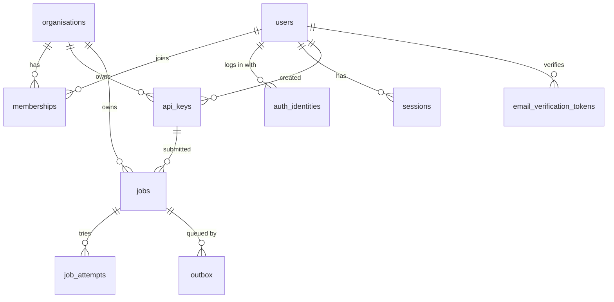

# Database plan

Status: **Draft for review** · Last updated: 2026-10-08

This document lays out the PostgreSQL schema, the indexes, and the rules for changing and operating it. It follows [`ARCHITECTURE.md`](ARCHITECTURE.md) and the decisions in [`discussion/NOTEPAD.md`](discussion/NOTEPAD.md) (D3, D5, D7, D8, D10, D12, D13, D16 to D18).

Items marked **Assumption** are my choices, not yours yet. They are collected in section 13 for you to accept or change.

---

## 1. Principles

1. **Postgres is the system of record.** RabbitMQ only says "a job is ready" (D5). If RabbitMQ lost everything, the job table still tells us what to run again.
2. **Every table is scoped by organisation** where it holds customer data (D8). Every query on those tables filters on `organisation_id`.
3. **UUIDv7 primary keys** on every table, generated with `DEFAULT uuidv7()` (D13). The app may generate one itself when it needs the id before the insert.
4. **Leave room for Phase 2 now** (D10): `priority`, `run_at` and `cancel_requested` exist on `jobs` from day one.
5. **Adding a column later to a big table is the painful part.** So we add the columns we know we need now, and keep everything else simple.
6. **The database is accessed only through the `postgres` adapter** (see `ARCHITECTURE.md` section 6). No other code writes SQL.

## 2. Conventions

| Topic | Rule |
|---|---|
| Names | `snake_case`, plural table names, singular column names |
| Primary key | `id uuid PRIMARY KEY DEFAULT uuidv7()` |
| Foreign keys | `<table_singular>_id`, always indexed, `ON DELETE` rule stated per table |
| Time | `timestamptz` only, stored in UTC. `created_at` on every table. `updated_at` on tables that change |
| Status columns | `text` with a `CHECK` constraint, **not** a Postgres `ENUM`. Changing a CHECK is one fast migration. Changing an ENUM is awkward. **Assumption** |
| Flexible data | `jsonb`, only where the shape differs per job type (payload, result, error) |
| Secrets | Only hashes are stored, as `bytea`. Never plain text |
| Text limits | `CHECK (char_length(...) <= N)` on user-controlled text |
| Extensions | None needed. `uuidv7()` is built into PostgreSQL 18, and email matching uses a `lower(email)` index, not `citext` |
| Soft delete | Not used by default. Rows that must stay (users, organisations) get a `status` or `disabled_at` instead |

## 3. Entity overview



Job types (`ocr.extract` and so on) are **not** a table. They live in code as registered handlers (D4). `jobs.type` is a plain string, and the API rejects types no handler is registered for.

## 4. Tables

### 4.1 `organisations`

| Column | Type | Notes |
|---|---|---|
| id | uuid | PK |
| name | text NOT NULL | 1 to 200 characters |
| slug | text NOT NULL | Unique, lower-case, URL-safe |
| status | text NOT NULL | `active`, `suspended`. Default `active` |
| created_at, updated_at | timestamptz NOT NULL | |

Indexes: unique on `slug`.

`suspended` lets us block an organisation's API access without deleting data.

### 4.2 `users`

| Column | Type | Notes |
|---|---|---|
| id | uuid | PK |
| email | text NOT NULL | Stored as typed |
| display_name | text | Optional |
| email_verified_at | timestamptz | Null until verified |
| status | text NOT NULL | `active`, `disabled`. Default `active` |
| last_login_at | timestamptz | |
| created_at, updated_at | timestamptz NOT NULL | |

Indexes: **unique on `lower(email)`**, so `A@x.com` and `a@x.com` cannot both exist.

### 4.3 `auth_identities`

How a user proves who they are. Splitting this from `users` is what lets us add OAuth providers later without touching anything else (D7).

| Column | Type | Notes |
|---|---|---|
| id | uuid | PK |
| user_id | uuid NOT NULL | FK to `users`, `ON DELETE CASCADE` |
| provider | text NOT NULL | `password` now. `google`, `github` and others later |
| provider_subject | text NOT NULL | For `password`: the user's own id, so changing an email never needs a second update. For OAuth: the provider's user id |
| secret_hash | text | Argon2 hash for `password`. Null for OAuth |
| created_at | timestamptz NOT NULL | |

Indexes: unique on `(provider, provider_subject)`; index on `user_id`.

A user can have several identities (a password and a Google login for the same person).

**Security rule for OAuth later:** never link an OAuth login to an existing user just because the email matches, unless the provider says the email is verified. Doing so lets an attacker take over an account.

### 4.4 `sessions`

Server-side browser sessions for the frontend. **Assumption:** stored in the database, not as a self-contained token, so a session can be revoked instantly (logout, password change, disabled user). Nothing here is used by API keys.

| Column | Type | Notes |
|---|---|---|
| id | uuid | PK |
| user_id | uuid NOT NULL | FK to `users`, `ON DELETE CASCADE` |
| token_hash | bytea NOT NULL | SHA-256 of the random session token in the cookie |
| created_at | timestamptz NOT NULL | |
| expires_at | timestamptz NOT NULL | |
| revoked_at | timestamptz | |
| last_seen_at | timestamptz | For an idle timeout. Updated at most once per interval, like `api_keys.last_used_at` |
| ip, user_agent | text | For the user's "active sessions" view and for investigations |

Indexes: unique on `token_hash`; index on `user_id`; index on `expires_at` for cleanup.

### 4.4a `email_verification_tokens`

Email verification is in Phase 1 (D21). Password reset and invitation tables are deliberately **not** built now.

| Column | Type | Notes |
|---|---|---|
| id | uuid | PK |
| user_id | uuid NOT NULL | FK to `users`, `ON DELETE CASCADE` |
| email | text NOT NULL | The address being verified, so a token cannot verify a different address after an email change |
| token_hash | bytea NOT NULL | SHA-256 of the random token sent by email. The token itself is never stored |
| created_at | timestamptz NOT NULL | |
| expires_at | timestamptz NOT NULL | |
| used_at | timestamptz | Single use: set when redeemed |

Indexes: unique on `token_hash`; index on `user_id`; index on `expires_at` for cleanup.

How the email is actually sent is still open (see `ARCHITECTURE.md` section 18, item 6).

### 4.5 `memberships`

| Column | Type | Notes |
|---|---|---|
| organisation_id | uuid NOT NULL | FK to `organisations`, `ON DELETE CASCADE` |
| user_id | uuid NOT NULL | FK to `users`, `ON DELETE CASCADE` |
| role | text NOT NULL | `owner`, `admin`, `member`. **Assumption:** three roles |
| created_at | timestamptz NOT NULL | |

Primary key: `(organisation_id, user_id)`. Index on `user_id` (to list a user's organisations).

Rule enforced in the application: an organisation always keeps at least one `owner`.

### 4.6 `api_keys`

| Column | Type | Notes |
|---|---|---|
| id | uuid | PK |
| organisation_id | uuid NOT NULL | FK to `organisations`, `ON DELETE CASCADE` |
| created_by_user_id | uuid | FK to `users`, `ON DELETE SET NULL` |
| name | text NOT NULL | Label chosen by the user, 1 to 100 characters |
| key_prefix | text NOT NULL | The visible, non-secret part of `qfe_<prefix>_<secret>`. Used for lookup |
| key_hash | bytea NOT NULL | SHA-256 of the full key. See note below |
| scopes | text[] NOT NULL | For example `{jobs:read,jobs:write}`. A CHECK constraint allows only known scope names, so a typo such as `job:write` is rejected |
| created_at | timestamptz NOT NULL | |
| last_used_at | timestamptz | Updated at most once per interval, see section 8 |
| expires_at | timestamptz | Null means no expiry |
| revoked_at | timestamptz | Set on revoke. Takes effect on the next request |

Indexes: **unique on `key_prefix`** (the lookup path); index on `organisation_id`; index on `created_by_user_id`.

Why SHA-256 and not Argon2 for keys: API keys are long random strings, so there is nothing to guess and a fast hash is correct. Argon2 is for human-chosen passwords, which can be guessed (D7, D14). This runs on every API request, so speed matters. **Assumption**

Revoked and expired keys are kept, not deleted, so past jobs can still say which key submitted them.

### 4.7 `jobs`

The central table. Read and written constantly.

| Column | Type | Notes |
|---|---|---|
| id | uuid | PK. Time-ordered, so `ORDER BY id` is also creation order |
| organisation_id | uuid NOT NULL | FK to `organisations`, `ON DELETE RESTRICT` |
| api_key_id | uuid | FK to `api_keys`, `ON DELETE SET NULL`. Which key submitted it |
| type | text NOT NULL | Registered handler name, for example `ocr.extract` |
| type_version | text NOT NULL | Handler version at submit time |
| status | text NOT NULL | `queued`, `running`, `retrying`, `succeeded`, `failed`, `cancelled`. Default `queued` |
| payload | jsonb NOT NULL | Validated input. Size-capped, see section 8 |
| result | jsonb | Small results |
| result_ref | text | Storage reference when the result is a file or too large for the row |
| error | jsonb | `{code, message, retryable}` of the last failure |
| progress | smallint NOT NULL | 0 to 100. Default 0 |
| attempts | integer NOT NULL | Tries used so far. Default 0 |
| max_attempts | integer NOT NULL | From the handler's settings at submit time |
| priority | smallint NOT NULL | **Phase 2.** Default 0. Stored now, not used yet |
| run_at | timestamptz NOT NULL | **Phase 2.** Default `now()`. Stored now, not used yet |
| cancel_requested | boolean NOT NULL | **Phase 2.** Default `false`. Stored now, not used yet |
| idempotency_key | text | Client-supplied, optional, up to 255 characters |
| request_hash | bytea | Hash of type and payload, set with the key. Same key with a different request returns a conflict, not the old job |
| trace_id | text NOT NULL | 32 hex characters. Joins this row to logs and traces |
| lease_owner | text | Worker id holding the lease |
| lease_token | uuid | New random value on every claim. Every heartbeat and final write must match it, so a worker that lost its lease cannot overwrite a newer attempt |
| lease_expires_at | timestamptz | When the lease runs out unless extended |
| created_at | timestamptz NOT NULL | |
| started_at | timestamptz | First time it began running |
| finished_at | timestamptz | When it reached a final state |
| updated_at | timestamptz NOT NULL | |

Checks: `progress BETWEEN 0 AND 100`; `attempts >= 0`; `max_attempts >= 1`; status is one of the allowed values; at most one of `result` and `result_ref` is set (enforced by a CHECK).

Indexes:

| Index | Serves |
|---|---|
| `(organisation_id, id DESC)` | Listing an organisation's jobs, newest first, with keyset pagination |
| `(organisation_id, status, id DESC)` | Listing by status |
| **Partial** `(organisation_id) WHERE status IN ('queued','retrying','running')` | Counting active jobs for the quota (small, because only live jobs are in it) |
| **Partial** `(id) WHERE status = 'running'` | The recovery scan for jobs whose lease expired |
| **Unique partial** `(organisation_id, idempotency_key) WHERE idempotency_key IS NOT NULL` | Idempotent submit |
| `(api_key_id)` | Foreign key lookup, and cheap `SET NULL` when a key is deleted |

Why the recovery index does **not** include `lease_expires_at`: heartbeats update that column often. An indexed column that changes on every heartbeat stops Postgres from doing cheap in-place updates (HOT updates) and bloats the index. The running set is small, so scanning it and filtering on the lease is fast enough.

Table settings (see section 9): `fillfactor = 80` and tighter autovacuum, because rows are updated several times in their life.

### 4.8 `job_attempts`

One row per try. Shows why a job failed, and how long each try took.

| Column | Type | Notes |
|---|---|---|
| id | uuid | PK |
| job_id | uuid NOT NULL | FK to `jobs`, `ON DELETE CASCADE` |
| attempt_number | integer NOT NULL | 1, 2, 3... |
| worker_id | text | |
| started_at | timestamptz NOT NULL | |
| finished_at | timestamptz | Null while running |
| outcome | text | `succeeded`, `retryable_error`, `permanent_error`, `timeout`, `lease_lost` |
| error | jsonb | |
| trace_id | text | Same trace as the job |

Indexes: unique on `(job_id, attempt_number)`.

### 4.9 `outbox`

Messages waiting to be published to RabbitMQ (D12). A job gets a **new row for its first run and for every retry or recovery** (D22), so one job has many outbox rows over its life. A row is always written in the same transaction as the job status change that needs it.

| Column | Type | Notes |
|---|---|---|
| id | uuid | PK |
| job_id | uuid NOT NULL | FK to `jobs`, `ON DELETE CASCADE` |
| routing_key | text NOT NULL | Which queue or topic the message goes to |
| headers | jsonb NOT NULL | Includes `trace_id` |
| body | jsonb NOT NULL | The message. Carries the job id, not the payload |
| created_at | timestamptz NOT NULL | |
| run_at | timestamptz NOT NULL | Do not publish before this time. `now()` for a first run, later for a retry or a delayed job (D22) |
| published_at | timestamptz | Null until RabbitMQ has confirmed it received the message |
| publish_attempts | integer NOT NULL | Default 0. For monitoring a stuck message |
| last_error | text | |

Indexes: **partial** `(run_at, id) WHERE published_at IS NULL`; index on `job_id` (needed when jobs are purged). The relay's query is:

```sql
SELECT ... FROM outbox
WHERE published_at IS NULL
  AND run_at <= now()
ORDER BY run_at, id
LIMIT :batch
FOR UPDATE SKIP LOCKED;
```

`SKIP LOCKED` lets several relays run without taking the same rows. The partial index stays small because published rows leave it.

Rules for the relay:
- It sets `published_at` only **after RabbitMQ confirms** it received the message (publisher confirms). Setting it earlier could lose a message.
- Holding row locks while talking to RabbitMQ needs a short timeout, so a slow broker cannot hold database locks for long.
- Publishing order is **not** guaranteed to match creation order. UUIDv7 ids are made at insert time, not at commit time. For a queue that is fine, and nothing may depend on strict order.
- A message can be published twice (if the relay crashes after publishing but before saving `published_at`). That is covered by the at-least-once rule: handlers are safe to run twice, and the claim step refuses a job that is already running or finished.

Published rows are deleted by a cleanup job after a short time (section 10).

## 5. How the main operations touch the database

| Operation | What happens | Transaction |
|---|---|---|
| Submit job | Check quota, insert `jobs`, insert `outbox` | One transaction. If the idempotency key already exists, return the existing job instead |
| Relay publish | Select unpublished outbox rows with `SKIP LOCKED`, publish, set `published_at` | One transaction per batch |
| Worker claim | `UPDATE jobs SET status='running', lease_owner=..., lease_token=<new random value>, lease_expires_at=..., attempts=attempts+1 WHERE id=... AND status IN ('queued','retrying')`, then insert `job_attempts` | One transaction. Zero rows updated means someone else has it, so do nothing |
| Heartbeat | Update `lease_expires_at` (and `progress` if reported), guarded by `WHERE id=... AND status='running' AND lease_token=...`. Zero rows updated means the lease was lost, so the worker stops | Single statement. Progress updates are throttled |
| Finish (success) | Same guard on the lease token. Set `succeeded`, result, `finished_at`, close the `job_attempts` row | One transaction. The RabbitMQ message is acknowledged **after** this commits |
| Retry (failure, attempts left) | Same guard on the lease token. Set `retrying`, close the `job_attempts` row, insert a **new `outbox` row** with a later `run_at` (the backoff time) | One transaction. The worker never talks to RabbitMQ to requeue |
| Fail (permanent error, or attempts used up) | Same guard. Set `failed`, store the error, close the `job_attempts` row | One transaction. The message goes to the dead-letter queue |
| Recover (lease expired) | Find `running` jobs whose lease has expired. If `attempts >= max_attempts`: set `failed` and close the open attempt as `lease_lost`. Otherwise: set `retrying`, close the attempt as `lease_lost`, insert a new `outbox` row | Runs in the `maintenance` container. One transaction per job, claimed with `SKIP LOCKED`. Prevents a job that crashes every worker from looping forever |
| Poll | `SELECT` by `id` and `organisation_id` | Read only |

The conditional `WHERE status IN (...)` on the claim is what stops two workers running one job even if the broker delivers twice.

## 6. Active-jobs quota and the rate limiter

`ARCHITECTURE.md` section 9 lists "active jobs per organisation" with the Redis-backed limiter. A live count of jobs is not a rate, and a Redis counter can drift from the truth if a worker crashes. **My proposal:** the authoritative count comes from the database, using the partial index in 4.7, inside the submit transaction. Redis stays responsible for the three request-rate limits. If you accept this, `ARCHITECTURE.md` section 9 gets a one-line update.

**Keep the count cheap.** Counting every live job gets slower as an organisation's backlog grows. So the check counts only up to the cap: `SELECT count(*) FROM (SELECT 1 FROM jobs WHERE organisation_id = :org AND status IN ('queued','retrying','running') LIMIT :cap + 1)`. The cost never grows past the cap. The cap value is therefore a performance setting as well as a fairness one, and should stay in the low thousands.

Accepted trade-off: two submits at the same instant can both pass the check and exceed the quota by a few jobs. Locking the organisation row would prevent that but would serialise all submits for that organisation. Running a few over is the better trade for now. **Assumption**

## 7. Data that is not in Postgres

| Data | Where | Why |
|---|---|---|
| Job files (inputs, outputs) | Object storage (SeaweedFS in Docker, D20), referenced from `payload` or `result_ref` | Keeps rows small (D6) |
| Rate limit counters | Redis | Fast and expiring (D17) |
| Queue messages, retry delay queues, dead-letter queue | RabbitMQ | Delivery only (D5) |

The dead-letter queue is a delivery detail. The truth about a failed job is `jobs.status = 'failed'` plus its `job_attempts` rows.

## 8. Write load and size limits

Two things can quietly hurt a busy jobs table, so both get rules:

- **Heartbeats and progress are throttled.** A worker updates `lease_expires_at` on a fixed interval (for example every third of the lease time), and writes `progress` at most once every few seconds. Not once per percent.
- **`api_keys.last_used_at` is throttled.** It is updated at most once per interval per key (for example every few minutes), not on every request, so reading a key does not turn into a write on the hottest path.
- **Payload size is capped** (default to be set, tuning value). Big inputs must be uploaded to storage and passed by reference. This protects the table, the WAL and the backups.
- **Result size is capped** the same way. Larger results go to storage and `result_ref`.

## 9. Performance and tuning plan

| Area | Plan |
|---|---|
| Updates | Keep frequently changed columns (`progress`, lease, `updated_at`) out of indexes so updates stay cheap. Set `fillfactor = 80` on `jobs` |
| Vacuum | Lower the autovacuum thresholds on `jobs`, `job_attempts` and `outbox`, which see heavy updates and deletes |
| Pagination | Keyset pagination on `id` (time-ordered), never `OFFSET` |
| Connections | One async pool per process (API, worker, relay). Add PgBouncer when the number of processes grows. Check its mode against the driver's prepared statement behaviour when versions are pinned |
| Roles | `qfe_migrator` (can change the schema), `qfe_app` (read and write data only), optionally `qfe_readonly` for dashboards. The running services never use the migrator role |
| Monitoring | Postgres exporter into Prometheus: connections, locks, replication lag, table and index bloat, slow queries (`pg_stat_statements`) |

## 10. Retention and cleanup

All values are tuning settings with documented defaults. Exact defaults are not decided yet. Every cleanup below runs in the `maintenance` container (D19), claiming its rows with `SKIP LOCKED` so several copies can run safely.

| Data | Rule |
|---|---|
| `outbox` published rows | Delete in small batches after a short delay (hours to a day) |
| `sessions` expired or revoked | Delete after a grace period |
| `jobs` and `job_attempts` | Keep for a configurable number of days. Purge in batches by `id` range (cheap because ids are time-ordered), and **only rows in a final state** (`succeeded`, `failed`, `cancelled`), so an old job that is stuck mid-flight is never deleted from under a worker. Payload and result can be cleared earlier than the row if needed |
| Object storage files | Bucket lifecycle rule matched to the job retention |

Deleting in large single statements is avoided: batches keep locks short and WAL manageable.

## 11. Growth plan (not built in Phase 1)

`jobs`, `job_attempts` and `outbox` are the tables that will get large.

**Partitioning by time is the planned path, with one known problem to solve first.** In Postgres, a partitioned table's primary key and unique constraints must include the partition column. Our unique rule on `(organisation_id, idempotency_key)` would then only hold within one partition, which breaks idempotency across a partition boundary.

When partitioning becomes necessary, the planned answer is to move idempotency into its own small table, `idempotency_keys (organisation_id, key, job_id, request_hash, created_at)`, which is not partitioned and is cleaned up by age. That is a contained change, so we do **not** build it now. It is recorded here so nobody discovers the problem under pressure.

**Partition key idea (to verify before relying on it):** UUIDv7 ids are time-ordered, so `jobs` could be partitioned by **id range** directly, with no extra time column. The primary key (`id`) already contains the partition key, and foreign keys from `job_attempts` and `outbox` to a partitioned `jobs` are supported by PostgreSQL 12 and later. A search supports this in general terms. The idempotency problem above remains either way.

Other growth levers, in order of effort: raise retention pressure (shorter retention); archive old rows to cheaper storage; read replicas for listing queries; then partitioning.

## 12. Migrations and change process

- **Alembic** manages the schema. Created with `alembic init` (project rule: use the tool's generator, do not hand-write the skeleton).
- One migration per logical change. Autogenerated migrations are always reviewed and edited by hand.
- **Safe, step-by-step changes (expand and contract):** add the new column or table, deploy code that handles both, move data, then remove the old one in a later release. No release depends on a migration running at the same instant as the code.
- Large-table changes: add indexes with `CREATE INDEX CONCURRENTLY`; add constraints as `NOT VALID` then `VALIDATE`; avoid rewriting the whole table.
- Migrations run from a one-shot `migrate` container before the API and workers start.
- CI runs migrations on an empty database, and also checks that upgrading from the previous release works.
- Rollback means a new forward migration. Down-migrations are not relied on in production. **Assumption**
- Every schema change updates this document in the same commit.

## 13. Assumptions for you to confirm

| # | Assumption | If you disagree |
|---|---|---|
| A1 | Status columns are `text` with `CHECK`, not Postgres `ENUM` | Switch to ENUM types. Slightly stricter, harder to change |
| A2 | Browser sessions are stored server-side in `sessions` so they can be revoked at once | Use signed tokens instead. Simpler, but revocation is harder |
| A3 | Three roles: `owner`, `admin`, `member` | Fewer or more roles |
| A4 | API keys use SHA-256 (random keys), passwords use Argon2 | Use Argon2 for keys too. Safer on paper, much slower on every request |
| A5 | Active-jobs quota is counted from the database, not Redis (section 6) | Keep it in Redis and accept drift and reconciliation work |
| A6 | A few jobs over the quota under concurrent submits is acceptable | Lock the organisation row on submit |
| A7 | No partitioning in Phase 1, with the idempotency-table plan for later | Partition from the start and build the idempotency table now |
| A8 | Tenant isolation is enforced in application code, scoped by `organisation_id` in every query | Add Postgres row-level security as a second layer. Strong safety net, more setup and testing. A reviewer's condition for accepting A8: a contract test must prove that one organisation can never read another's jobs through any repository method |
| A9 | Down-migrations are not relied on | Maintain tested down-migrations |

## 14. Not in this plan

- Webhooks (Phase 2): will need `webhook_endpoints` and `webhook_deliveries` tables, designed when Phase 2 starts.
- Audit log of user and key actions: not discussed yet. Likely wanted for a real-world platform, so worth deciding early.
- Billing and usage metering: not discussed.
- Per-organisation limit overrides: wishlist.
- Password reset and member invitations: deferred to a later phase (D21). No tables for them yet.
- How verification emails are sent: open (`ARCHITECTURE.md` section 18, item 6).
- Deleting an organisation or a user: `jobs.organisation_id` is `ON DELETE RESTRICT`, so an organisation with jobs cannot be deleted directly. The intended flow (disable, purge jobs after retention, then delete) is not designed yet, and neither is erasing a user's personal data.
- CSRF protection for cookie sessions: not designed yet (`ARCHITECTURE.md` section 18, item 8).

## 15. Still to verify before building

- PostgreSQL 18 behaviour that this plan relies on, checked against the official docs: `uuidv7()`, partial indexes, `SKIP LOCKED`, HOT updates, and the `postgres:18` image tag (open items V2 and V3 in the notepad).
- SQLAlchemy 2 async, asyncpg and Alembic versions that work together with the chosen Python.
- Whether PgBouncer is needed in the first version at all.
