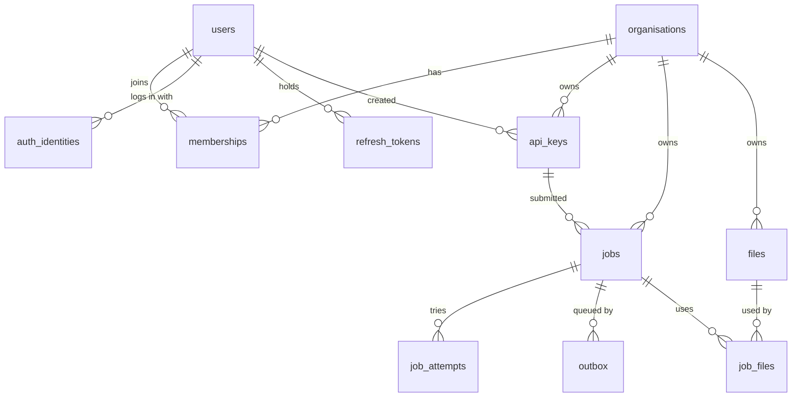

# Database plan

Status: **Draft for review** · Last updated: 2026-10-10

This document lays out the PostgreSQL schema, the indexes, and the rules for changing and operating it. It follows [`ARCHITECTURE.md`](ARCHITECTURE.md) and the decisions in [`discussion/NOTEPAD.md`](discussion/NOTEPAD.md) (D3, D5, D7, D8, D10, D12, D13, D16 to D18, D22 to D40).

---

## 1. Principles

1. **Postgres is the system of record.** RabbitMQ only says "a job is ready" (D5). If RabbitMQ lost everything, the job table still tells us what to run again.
2. **Every table that holds customer data is scoped by organisation** (D8). Every query on those tables filters on `organisation_id`.
3. **UUIDv7 primary keys** on every table, generated with `DEFAULT uuidv7()` (D13). The app may generate one itself when it needs the id before the insert.
4. **Leave room for Phase 2 now** (D10): `priority` and `cancel_requested` exist on `jobs` from day one. `run_at` is used from Phase 1, for retries (D24).
5. **Adding a column later to a big table is the painful part.** So we add the columns we know we need now, and keep everything else simple.
6. **The database is accessed only through the `postgres` adapter** (see `ARCHITECTURE.md` section 6). No other code writes SQL.

## 2. Conventions

| Topic | Rule |
|---|---|
| Names | `snake_case`, plural table names, singular column names |
| Primary key | `id uuid PRIMARY KEY DEFAULT uuidv7()` |
| Foreign keys | `<table_singular>_id`, always indexed, `ON DELETE` rule stated per table |
| Time | `timestamptz` only, stored in UTC. `created_at` on every table. `updated_at` on tables that change. Anything compared with "now" uses the database clock (`now()`), never the application clock |
| Status columns | `text` with a `CHECK` constraint, **not** a Postgres `ENUM`. Changing a CHECK is one fast migration. Changing an ENUM is awkward (A1, approved) |
| Flexible data | `jsonb`, only where the shape differs per job type (payload, result, error) |
| Secrets | Only hashes are stored, as `bytea`. Never plain text |
| Text limits | `CHECK (char_length(...) <= N)` on user-controlled text |
| Extensions | None needed. `uuidv7()` is built into PostgreSQL 18, and email matching uses a `lower(email)` index, not `citext` |
| Soft delete | Not used by default. Rows that must stay (users, organisations) get a `status` or `disabled_at` instead |

## 3. Entity overview



Job types (`ocr.extract` and so on) are **not** a table. They live in code as registered job type definitions (D4, D28). `jobs.type` is a plain string, and the API rejects types that are not registered.

## 4. Tables

### 4.1 `organisations`

| Column | Type | Notes |
|---|---|---|
| id | uuid | PK |
| name | text NOT NULL | 1 to 200 characters |
| slug | text NOT NULL | Unique, lower-case, URL-safe |
| status | text NOT NULL | `active`, `suspended`. Default `active` |
| created_at, updated_at | timestamptz NOT NULL | |

Indexes: unique on `slug`.

`suspended` lets us block an organisation's API access without deleting data. Signup creates one organisation for the new user (D30).

### 4.2 `users`

| Column | Type | Notes |
|---|---|---|
| id | uuid | PK |
| email | text NOT NULL | Stored as typed |
| display_name | text | Optional |
| email_verified_at | timestamptz | Stays null in Phase 1, because email verification is deferred (D30). The column exists so verification can be added later without a migration of this table |
| status | text NOT NULL | `active`, `disabled`. Default `active` |
| last_login_at | timestamptz | |
| created_at, updated_at | timestamptz NOT NULL | |

Indexes: **unique on `lower(email)`**, so `A@x.com` and `a@x.com` cannot both exist.

Phase 1 signup accepts any email address, verified or not.

### 4.3 `auth_identities`

How a user proves who they are. Splitting this from `users` is what lets us add OAuth providers later without touching anything else (D7).

| Column | Type | Notes |
|---|---|---|
| id | uuid | PK |
| user_id | uuid NOT NULL | FK to `users`, `ON DELETE CASCADE` |
| provider | text NOT NULL | `password` now. `google`, `github` and others later |
| provider_subject | text NOT NULL | For `password`: the user's own id, so changing an email never needs a second update. For OAuth: the provider's user id |
| secret_hash | text | Argon2 hash for `password`. Null for OAuth |
| created_at | timestamptz NOT NULL | |

Indexes: unique on `(provider, provider_subject)`; index on `user_id`.

A user can have several identities (a password and a Google login for the same person).

**Security rule for OAuth later:** never link an OAuth login to an existing user just because the email matches, unless the provider says the email is verified. Doing so lets an attacker take over an account.

### 4.4 `refresh_tokens`

Server-side record of refresh tokens for the browser login (D32). Replaces the earlier `sessions` table. Nothing here is used by API keys.

| Column | Type | Notes |
|---|---|---|
| id | uuid | PK, and the token's `jti` claim. Unique by definition |
| family_id | uuid NOT NULL | All tokens descended from one login share it |
| user_id | uuid NOT NULL | FK to `users`, `ON DELETE CASCADE` |
| created_at | timestamptz NOT NULL | |
| expires_at | timestamptz NOT NULL | This token's own lifetime |
| family_expires_at | timestamptz NOT NULL | The **absolute** end of the login. Set at login, copied to every rotated token, never extended. After it, refresh is refused (D40) |
| used_at | timestamptz | Set when this token is exchanged for a new one |
| revoked_at | timestamptz | Set on logout or when reuse is detected |
| replaced_by | uuid | The token issued in exchange |
| ip, user_agent | text | For investigations |

Rules:
- Every refresh **rotates** the token: the old one gets `used_at` and `replaced_by`, and a new row is inserted, in one transaction. The new row's `expires_at` never goes past `family_expires_at`.
- **Reuse window (D37).** If a token with `used_at` set is presented again **within the reuse window** (a tuning value, for example 10 to 30 seconds), the answer is a distinct "already refreshed" error and nothing is revoked. This covers two browser tabs, or a reload during a refresh.
- If a used token is presented again **after the window**, the **whole family is revoked** (set `revoked_at` on every row with that `family_id`).
- Logout revokes the family. The short-lived access token stays valid until it expires (accepted).

Indexes: index on `family_id`; index on `user_id`; index on `expires_at` for cleanup.

### 4.5 `memberships`

| Column | Type | Notes |
|---|---|---|
| organisation_id | uuid NOT NULL | FK to `organisations`, `ON DELETE CASCADE` |
| user_id | uuid NOT NULL | FK to `users`, `ON DELETE CASCADE` |
| role | text NOT NULL | `owner`, `admin`, `member` (A3, approved) |
| created_at | timestamptz NOT NULL | |

Primary key: `(organisation_id, user_id)`. Index on `user_id` (to list a user's organisations).

Rule enforced in the application: an organisation always keeps at least one `owner`.

### 4.6 `api_keys`

| Column | Type | Notes |
|---|---|---|
| id | uuid | PK |
| organisation_id | uuid NOT NULL | FK to `organisations`, `ON DELETE CASCADE` |
| created_by_user_id | uuid | FK to `users`, `ON DELETE SET NULL` |
| name | text NOT NULL | Label chosen by the user, 1 to 100 characters |
| key_prefix | text NOT NULL | The visible, non-secret part of `qfe_<prefix>_<secret>`. Used for lookup |
| key_hash | bytea NOT NULL | SHA-256 of the full key. See note below |
| scopes | text[] NOT NULL | Allowed values: `jobs:read`, `jobs:write`, `files:read`, `files:write`. A CHECK constraint rejects anything else, so a typo such as `job:write` fails |
| created_at | timestamptz NOT NULL | |
| last_used_at | timestamptz | Updated at most once per interval, see section 8 |
| expires_at | timestamptz | Null means no expiry |
| revoked_at | timestamptz | Set on revoke. Takes effect on the next request |

Indexes: **unique on `key_prefix`** (the lookup path); index on `organisation_id`; index on `created_by_user_id`.

Why SHA-256 and not Argon2 for keys: API keys are long random strings, so there is nothing to guess and a fast hash is correct. Argon2 is for human-chosen passwords, which can be guessed (A4, approved). This runs on every API request, so speed matters.

Revoked and expired keys are kept, not deleted, so past jobs can still say which key submitted them.

### 4.7 `files`

Uploaded inputs and stored results (D31). Files live in object storage; this table is the record.

| Column | Type | Notes |
|---|---|---|
| id | uuid | PK. This is the `file_id` clients use |
| organisation_id | uuid NOT NULL | FK to `organisations`, `ON DELETE RESTRICT` |
| kind | text NOT NULL | `input` or `result` |
| storage_key | text NOT NULL | Generated by the server, namespaced by organisation. Never taken from the client |
| display_name | text NOT NULL | File name shown to users, up to 255 characters |
| content_type | text NOT NULL | |
| size_bytes | bigint NOT NULL | The size the client declared. Checked against the real size (see below) |
| status | text NOT NULL | `pending` (link issued, upload not yet confirmed) or `available`. Default `pending` |
| created_at | timestamptz NOT NULL | |
| expires_at | timestamptz | For `pending` files: when an unused upload is purged |

Rules:
- A file becomes `available` the first time a job submit checks it with a HEAD request to storage and finds the object. The real size from that check must match the declared limit.
- Download links for results are generated on read and are short-lived. They are never stored.

Indexes: unique on `storage_key`; index on `organisation_id`; partial index on `expires_at` where `status = 'pending'`.

### 4.8 `job_files`

Links a job to its **input** files, so cleanup never removes a file a job still needs. A result file is linked by `jobs.result_file_id`, so every file has exactly one kind of link (D40). Both links are real foreign keys, so the database refuses to delete a file that is still used.

| Column | Type | Notes |
|---|---|---|
| job_id | uuid NOT NULL | FK to `jobs`, `ON DELETE CASCADE` |
| file_id | uuid NOT NULL | FK to `files`, `ON DELETE RESTRICT` |

Primary key: `(job_id, file_id)`. Index on `file_id`.

Written in the submit transaction. The input files' rows are locked (`FOR SHARE`) in that same transaction, so cleanup cannot delete them between the check and the insert.

### 4.9 `jobs`

The central table. Read and written constantly.

| Column | Type | Notes |
|---|---|---|
| id | uuid | PK. Time-ordered, so `ORDER BY id` is also creation order |
| organisation_id | uuid NOT NULL | FK to `organisations`, `ON DELETE RESTRICT` |
| api_key_id | uuid | FK to `api_keys`, `ON DELETE SET NULL`. Which key submitted it |
| type | text NOT NULL | Registered job type, for example `ocr.extract` |
| type_version | text NOT NULL | Job type version at submit time |
| status | text NOT NULL | `queued`, `running`, `retrying`, `succeeded`, `failed`, `cancelled`. Default `queued` |
| payload | jsonb NOT NULL | Validated input. Size-capped, see section 8 |
| result | jsonb | Small results |
| result_file_id | uuid | FK to `files`. Set when the result is a file or too large for the row |
| error | jsonb | `{code, message, retryable}` of the last failure |
| progress | smallint NOT NULL | 0 to 100. Default 0 |
| attempts | integer NOT NULL | Tries used so far. Default 0 |
| max_attempts | integer NOT NULL | From the job type's settings at submit time. Counts the first run plus the retries (default plan: 4) |
| priority | smallint NOT NULL | **Phase 2.** Default 0. Stored now, not used yet |
| run_at | timestamptz NOT NULL | **Do not run before this time.** Default `now()`. Set to `now() + delay` on a retry (D24). Used from Phase 1. `outbox.run_at` is a copy for fast relay lookups |
| cancel_requested | boolean NOT NULL | **Phase 2.** Default `false`. Stored now, not used yet |
| idempotency_key | text | Client-supplied, optional, up to 255 characters |
| request_hash | bytea | Hash of type and payload, set with the key. Same key with a different request returns a conflict, not the old job |
| trace_id | text NOT NULL | 32 hex characters. Joins this row to logs and traces |
| lease_owner | text | Worker id holding the lease |
| lease_token | uuid | New random value on every claim. Every heartbeat and final write must match it, so a worker that lost its lease cannot overwrite a newer attempt |
| lease_expires_at | timestamptz | When the lease runs out unless extended |
| sweep_count | smallint NOT NULL | How many times the safety-net sweep has re-queued this job since its last claim. Default 0. Reset to 0 at claim (D38) |
| last_enqueued_at | timestamptz NOT NULL | When a message was last put on the queue for this job. Set in the same transaction as every outbox insert. Default `now()` (D38) |
| created_at | timestamptz NOT NULL | |
| started_at | timestamptz | First time it began running |
| finished_at | timestamptz | When it reached a final state |
| updated_at | timestamptz NOT NULL | |

Checks: `progress BETWEEN 0 AND 100`; `attempts >= 0`; `max_attempts >= 1`; status is one of the allowed values; at most one of `result` and `result_file_id` is set.

Indexes:

| Index | Serves |
|---|---|
| `(organisation_id, id DESC)` | Listing an organisation's jobs, newest first, with keyset pagination |
| `(organisation_id, status, id DESC)` | Listing by status, for example `status=failed` |
| **Partial** `(organisation_id) WHERE status IN ('queued','retrying','running')` | Counting active jobs for the cap (small, because only live jobs are in it) |
| **Partial** `(id) WHERE status = 'running'` | The recovery scan for jobs whose lease expired |
| **Partial** `(run_at) WHERE status IN ('queued','retrying')` | The safety-net sweep |
| **Unique partial** `(organisation_id, idempotency_key) WHERE idempotency_key IS NOT NULL` | Idempotent submit |
| `(api_key_id)` | Foreign key lookup, and cheap `SET NULL` when a key is deleted |
| `(result_file_id)` | Foreign key lookup |

Why the recovery index does **not** include `lease_expires_at`: heartbeats update that column often. An indexed column that changes on every heartbeat stops Postgres from doing cheap in-place updates (HOT updates) and bloats the index. The running set is small, so scanning it and filtering on the lease is fast enough. The sweep index does include `run_at`, which only changes on a retry, not on heartbeats.

Table settings (see section 9): `fillfactor = 80` and tighter autovacuum, because rows are updated several times in their life.

### 4.10 `job_attempts`

One row per try. Shows why a job failed, and how long each try took. Exposed by `GET /v1/jobs/{id}/attempts`.

| Column | Type | Notes |
|---|---|---|
| id | uuid | PK |
| job_id | uuid NOT NULL | FK to `jobs`, `ON DELETE CASCADE` |
| attempt_number | integer NOT NULL | 1, 2, 3... |
| worker_id | text | |
| started_at | timestamptz NOT NULL | |
| finished_at | timestamptz | Null while running |
| outcome | text | `succeeded`, `retryable_error`, `permanent_error`, `timeout`, `lease_lost` |
| error | jsonb | |
| trace_id | text | Same trace as the job |

Indexes: unique on `(job_id, attempt_number)`.

### 4.11 `outbox`

Messages waiting to be published to RabbitMQ (D12). A job gets a **new row for its first run and for every retry, recovery or sweep** (D22, D27), so one job has many outbox rows over its life. A row is always written in the same transaction as the job status change that needs it.

| Column | Type | Notes |
|---|---|---|
| id | uuid | PK |
| job_id | uuid NOT NULL | FK to `jobs`, `ON DELETE CASCADE` |
| routing_key | text NOT NULL | The job type. The relay publishes to the queue for that type (D28) |
| reason | text NOT NULL | `submit`, `retry`, `recovery` or `sweep` (CHECK). Used for metrics and to count sweeps per job |
| headers | jsonb NOT NULL | Includes `trace_id` |
| body | jsonb NOT NULL | The message. Carries the job id, not the payload |
| created_at | timestamptz NOT NULL | |
| run_at | timestamptz NOT NULL | Do not publish before this time. Same value as `jobs.run_at` for a retry, `now()` for a first run, recovery or sweep |
| published_at | timestamptz | Null until RabbitMQ has confirmed the message was received **and routed** |
| publish_attempts | integer NOT NULL | Default 0. For monitoring a stuck message |
| last_error | text | |

Indexes: **partial** `(run_at, id) WHERE published_at IS NULL`; `(job_id)` (finds a job's unpublished rows, and is used when jobs are purged). The relay's query is:

```sql
SELECT ... FROM outbox
WHERE published_at IS NULL
  AND run_at <= now()
ORDER BY run_at, id
LIMIT :batch
FOR UPDATE SKIP LOCKED;
```

`SKIP LOCKED` lets several relays run without taking the same rows. The partial index stays small because published rows leave it.

Rules for the relay:
- It publishes with the mandatory flag and publisher confirms. RabbitMQ returns an unroutable message before it confirms. A returned message counts as a **failed publish**: `published_at` stays null, and `publish_attempts` and `last_error` are updated. It sets `published_at` only after a confirm with no return.
- Holding row locks while talking to RabbitMQ needs a short timeout, so a slow broker cannot hold database locks for long.
- Publishing order is **not** guaranteed to match creation order. UUIDv7 ids are made at insert time, not at commit time. For a queue that is fine, and nothing may depend on strict order.
- A message can be published twice (if the relay crashes after publishing but before saving `published_at`). That is covered by the at-least-once rule: handlers are safe to run twice, and the claim step refuses a job that is already running, finished, or not yet due.
- A row that fails to publish many times is logged, counted and alerted on. Failing the job after N tries is deferred.

Published rows are deleted by a cleanup job after a short time (section 10).

## 5. How the main operations touch the database

| Operation | What happens | Transaction |
|---|---|---|
| Submit job | **Before the transaction:** check each file in the payload against storage (HEAD) and mark found files `available`. **Then, in one transaction, in this order:** take the organisation's advisory lock; check the idempotency key (return the existing job if it matches); re-read the file rows (still `available`, same organisation, not expired) and lock them (`FOR SHARE`); capped count of active jobs; insert `jobs`, `job_files` and an `outbox` row (`reason = submit`) | One transaction. **No network call while the lock is held** (D36), so the lock lasts a few milliseconds. Released at commit |
| Relay publish | Select due, unpublished outbox rows with `SKIP LOCKED`, publish with confirms, set `published_at` only on a clean confirm | One transaction per batch |
| Worker claim | `UPDATE jobs SET status='running', lease_owner=:w, lease_token=:new_random, lease_expires_at=now()+:lease, attempts=attempts+1, sweep_count=0, started_at=COALESCE(started_at, now()) WHERE id=:id AND status IN ('queued','retrying') AND run_at <= now()`, then insert `job_attempts` | One transaction. Zero rows updated means refused: ack and log, nothing else. **Ack after the commit** |
| Heartbeat | Update `lease_expires_at` (and `progress` if reported), guarded by `WHERE id=... AND status='running' AND lease_token=...`. Zero rows updated means the lease was lost, so the worker stops and the attempt is recorded as `lease_lost` | Single statement. Progress updates are throttled |
| Finish (success) | Same guard on the lease token. Set `succeeded`, result, `finished_at`, close the `job_attempts` row | One transaction |
| Retry (failure, attempts left) | Same guard on the lease token. Set `retrying`, set `jobs.run_at = now() + :delay`, close the `job_attempts` row, insert a **new `outbox` row** (`reason = retry`) with the same `run_at`, and set `last_enqueued_at = now()` | One transaction. The worker never talks to RabbitMQ to requeue |
| Fail (permanent error, or attempts used up) | Same guard. Set `failed`, store the error, `finished_at`, close the `job_attempts` row | One transaction. Nothing else: there is no dead-letter queue |
| Recover (lease expired) | Find `running` jobs whose lease has expired. If `attempts >= max_attempts`: set `failed` and close the open attempt as `lease_lost`. Otherwise: set `retrying`, set `run_at = now() + :delay` (the same backoff function as retries, so a job that crashes its worker is not retried at once), close the attempt as `lease_lost`, insert a new `outbox` row (`reason = recovery`) with the same `run_at`, and set `last_enqueued_at = now()` | Runs in the `maintenance` container. One transaction per job, claimed with `SKIP LOCKED`. Prevents a job that crashes every worker from looping forever |
| Sweep | Find jobs with `status IN ('queued','retrying')`, `run_at < now() - wait`, `last_enqueued_at < now() - wait`, and no unpublished outbox row. For each: insert a new `outbox` row (`reason = sweep`, `run_at = now()`), set `sweep_count = sweep_count + 1` and `last_enqueued_at = now()`. `wait` is 5 minutes doubled for each earlier sweep: `5 min * 2^sweep_count`, capped at 1 hour (D38) | Runs in `maintenance`. One transaction per job, `SKIP LOCKED`, bounded batch. The history is on the `jobs` row, so deleting old outbox rows never resets it. Each re-queue is logged as a warning and counted |
| Unprocessable message, unknown job type | No database change. Ack, log an error (size only, no content), count a metric | None |
| List and poll | `SELECT` by `id` and `organisation_id`, or a keyset-paginated list filtered by status | Read only |
| Refresh token | Refuse if `family_expires_at` has passed. Mark the old token used, insert the new one (never past `family_expires_at`). If a used token is presented again: inside the reuse window return "already refreshed" and change nothing; after the window revoke the family | One transaction |

The conditional `WHERE status IN (...) AND run_at <= now()` on the claim is what stops two workers running one job, and what makes a duplicate or early message harmless, even if the broker delivers twice.

The relay (`outbox.run_at <= now()`) and the claim (`jobs.run_at <= now()`) both use the database clock, and both hold the same value written in one transaction. So a message the relay has published can never be refused as "too early".

## 6. The active-jobs cap (D29)

The cap is counted in Postgres, not Redis. A live count of jobs is not a rate, and a Redis counter can drift from the truth if a worker crashes. Redis keeps only the three request-rate limits.

**Keep the count cheap.** Counting every live job gets slower as an organisation's backlog grows. So the check counts only up to the cap:

```sql
SELECT count(*) FROM (
  SELECT 1 FROM jobs
  WHERE organisation_id = :org AND status IN ('queued','retrying','running')
  LIMIT :cap + 1
) t;
```

The cost never grows past the cap. The cap value is therefore a performance setting as well as a fairness one, and should stay in the low thousands.

**Keep the cap exact.** Submit takes a per-organisation, transaction-level advisory lock (`pg_advisory_xact_lock`, keyed on the organisation id), then does the idempotency check, the capped count, and the inserts. Concurrent submits for the **same** organisation run one at a time. Submits for different organisations do not block each other. The slow storage checks for the payload's files happen **before** the transaction, so no network call is made while the lock is held (D36). Inside the transaction, the order matters:

1. Take the lock.
2. Check the idempotency key. If a job already exists for it, return it. Checking before the lock would let two identical requests both pass; counting before the idempotency check could refuse a harmless repeat at the cap.
3. Re-read the file rows from the database and lock them (`FOR SHARE`).
4. Count up to the cap.
5. Insert.
6. Commit, which releases the lock.

A transaction-level lock is released at commit, which should make it safe with PgBouncer transaction pooling (a session-level lock would not be). This is on the Phase 0 verify list. If lock contention for a very busy organisation ever becomes a problem, a lock-free version that tolerates a small overshoot is deferred.

If two requests with the same idempotency key still collide, the unique-violation error is caught and the existing job is returned.

## 7. Data that is not in Postgres

| Data | Where | Why |
|---|---|---|
| File contents (inputs, results) | Object storage (SeaweedFS in Docker, D20), referenced by `files` | Keeps rows small (D6) |
| Rate limit counters (the three request-rate limits) | Redis | Fast and expiring (D17) |
| Queue messages | RabbitMQ, one queue per job type | Delivery only (D5, D28) |

The truth about a failed job is `jobs.status = 'failed'` plus its `job_attempts` rows (D25).

## 8. Write load and size limits

Things that can quietly hurt a busy jobs table, so each gets a rule:

- **Heartbeats and progress are throttled.** A worker updates `lease_expires_at` on a fixed interval (for example every third of the lease time), and writes `progress` at most once every few seconds. Not once per percent.
- **`api_keys.last_used_at` is throttled.** It is updated at most once per interval per key (for example every few minutes), not on every request, so reading a key does not turn into a write on the hottest path.
- **Payload size is capped** (default to be set, tuning value). Big inputs must be uploaded as files and referenced by id. This protects the table, the WAL and the backups.
- **Result size is capped** the same way. Larger results go to a file and `result_file_id`.
- **File size is capped** for the single-upload flow, and checked against the real object size.

## 9. Performance and tuning plan

| Area | Plan |
|---|---|
| Updates | Keep frequently changed columns (`progress`, lease, `updated_at`) out of indexes so updates stay cheap. Set `fillfactor = 80` on `jobs` |
| Vacuum | Lower the autovacuum thresholds on `jobs`, `job_attempts` and `outbox`, which see heavy updates and deletes |
| Pagination | Keyset pagination on `id` (time-ordered), never `OFFSET` |
| Connections | One async pool per process (API, worker, relay, maintenance). Add PgBouncer when the number of processes grows. Check its mode against the driver's prepared statement behaviour and the advisory lock when versions are pinned |
| Roles | `qfe_migrator` (can change the schema), `qfe_app` (read and write data only), optionally `qfe_readonly` for dashboards. The running services never use the migrator role |
| Monitoring | Postgres exporter into Prometheus: connections, locks, replication lag, table and index bloat, slow queries (`pg_stat_statements`) |

## 10. Retention and cleanup

All values are tuning settings with documented defaults. Exact defaults are not decided yet. Every cleanup below runs in the `maintenance` container (D19), claiming its rows with `SKIP LOCKED` so several copies can run safely.

| Data | Rule |
|---|---|
| `outbox` published rows | Delete in small batches after a short delay (hours to a day), whatever state the job is in. Nothing depends on them: the sweep keeps its history on the `jobs` row (D38) |
| `refresh_tokens` expired or revoked | Delete after a grace period |
| `files` with `status = 'pending'` past `expires_at` | Delete the row and the object (unused uploads) |
| `files` that jobs use | Follow job retention: removed with the last job that uses them, via `job_files` |
| `jobs` and `job_attempts` | Keep for a configurable number of days. Purge in batches by `id` range (cheap because ids are time-ordered), and **only rows in a final state** (`succeeded`, `failed`, `cancelled`), so an old job that is stuck mid-flight is never deleted from under a worker. Payload and result can be cleared earlier than the row if needed |
| Object storage | A bucket lifecycle rule matched to the retention, as a backstop |

Deleting in large single statements is avoided: batches keep locks short and WAL manageable.

## 11. Growth plan (not built in Phase 1)

`jobs`, `job_attempts` and `outbox` are the tables that will get large.

**Partitioning is the planned path, with one known problem to solve first.** In Postgres, a partitioned table's primary key and unique constraints must include the partition column. Our unique rule on `(organisation_id, idempotency_key)` would then only hold within one partition, which breaks idempotency across a partition boundary.

When partitioning becomes necessary, the planned answer is to move idempotency into its own small table, `idempotency_keys (organisation_id, key, job_id, request_hash, created_at)`, which is not partitioned and is cleaned up by age. That is a contained change, so we do **not** build it now. It is recorded here so nobody discovers the problem under pressure.

**Partition key idea (to verify before relying on it):** UUIDv7 ids are time-ordered, so `jobs` could be partitioned by **id range** directly, with no extra time column. The primary key (`id`) already contains the partition key, and foreign keys from `job_attempts`, `outbox` and `job_files` to a partitioned `jobs` are supported by PostgreSQL 12 and later. A search supports this in general terms. The idempotency problem above remains either way.

Other growth levers, in order of effort: shorter retention; archive old rows to cheaper storage; read replicas for listing queries; then partitioning.

## 12. Migrations and change process

- **Alembic** manages the schema. Created with `alembic init` (project rule: use the tool's generator, do not hand-write the skeleton).
- One migration per logical change. Autogenerated migrations are always reviewed and edited by hand.
- **Safe, step-by-step changes (expand and contract):** add the new column or table, deploy code that handles both, move data, then remove the old one in a later release. No release depends on a migration running at the same instant as the code.
- Large-table changes: add indexes with `CREATE INDEX CONCURRENTLY`; add constraints as `NOT VALID` then `VALIDATE`; avoid rewriting the whole table.
- Migrations run from a one-shot `migrate` container before the API and workers start.
- CI runs migrations on an empty database, and also checks that upgrading from the previous release works.
- Rollback means a new forward migration. Down-migrations are not relied on in production (A9, approved).
- Every schema change updates this document in the same commit.

## 13. Database assumptions and their status

| # | Assumption | Status |
|---|---|---|
| A1 | Status columns are `text` with `CHECK`, not Postgres `ENUM` | **Approved** (D34) |
| A2 | Browser sessions stored server-side in `sessions` | **Replaced** by access and refresh tokens (D32): `sessions` is gone, `refresh_tokens` takes its place |
| A3 | Three roles: `owner`, `admin`, `member` | **Approved** (D34) |
| A4 | API keys use SHA-256 (random keys), passwords use Argon2 | **Approved** (D34) |
| A5 | Active-jobs cap counted in Postgres, not Redis | **Approved** (D29) |
| A6 | A few jobs over the cap under concurrent submits is acceptable | **Replaced** (D29 amended): the cap is exact, using an advisory lock per organisation |
| A7 | No partitioning in Phase 1, with the idempotency-table plan for later | **Approved** (D34) |
| A8 | Tenant isolation enforced in application code, scoped by `organisation_id` in every query | **Approved** (D34), on the condition of a contract test proving one organisation can never read another's jobs or files through any repository method |
| A9 | Down-migrations are not relied on | **Approved** (D34) |

## 14. Not in this plan (deferred or undecided)

The full list, with the consequence of each, is in the "Deferred / later" section of the notepad. The ones that touch the database:

- Email verification tokens, password reset and invitation tables: deferred (D30). `users.email_verified_at` exists but stays empty.
- Webhooks (Phase 2): will need `webhook_endpoints` and `webhook_deliveries` tables, designed when Phase 2 starts.
- Manual retry of a failed job (Phase 2): reopens a final state, so it touches the state machine, the purge rule and the attempt counter. Needs its own spec.
- Audit log of user and key actions: hard to add later without gaps, so worth deciding early even if built later.
- Billing and usage metering.
- Per-organisation limit overrides: wishlist.
- Deleting an organisation or a user: `jobs.organisation_id` is `ON DELETE RESTRICT`, so an organisation with jobs cannot be deleted directly. The intended flow (disable, purge jobs after retention, then delete) is not designed, and neither is erasing a user's personal data.
- Idle session limit, "active sessions" view, access-token denylist: deferred. (The absolute login lifetime is built, through `refresh_tokens.family_expires_at`.)
- Handler version versus `jobs.type_version` mismatch: deferred.
- Row-level security as a second isolation layer: deferred.

## 15. Still to verify before building (Phase 0)

**Checked on 2026-10-10 (documentation and package metadata only, nothing run):** `uuidv7()` exists in the PostgreSQL 18 docs (signature `uuidv7([shift interval])`, no promised ordering within a millisecond); the `postgres:18` image exists; transaction-level advisory locks take a `bigint` (or two `int4`) key and are released at transaction end; SQLAlchemy 2.1 needs Python 3.11 or newer, the `[asyncio]` extra, and an explicit `asyncpg` driver choice; Alembic 1.19.2 and later cover SQLAlchemy 2.1; SeaweedFS supports lifecycle rules (not transition rules). Details are in the notepad.

**Still to verify, with running code:**

- Partial indexes, `SKIP LOCKED` and HOT-update behaviour on the `jobs` table under load (docs are known, behaviour is not measured).
- The advisory lock under PgBouncer transaction pooling, with an integration test. PgBouncer is not needed in the first version; if added, set `max_prepared_statements` to a non-zero value.
- The Alembic and SQLAlchemy versions together, on the chosen Python.
- SeaweedFS lifecycle expiry behaviour.
- Partitioning by id range (the idea in section 11).
