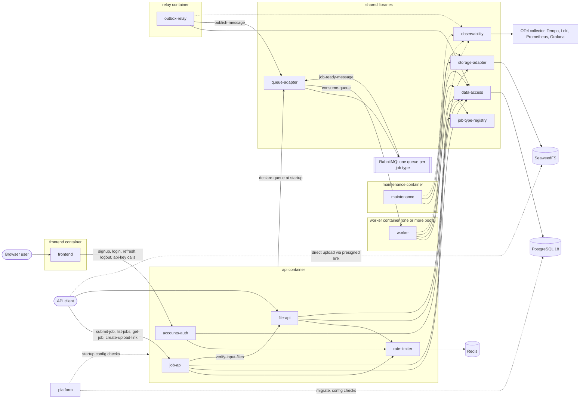

# Virtual implementation: overview

Phase 2 draft · 2026-10-10 · Written from three read-only sources: `docs/ARCHITECTURE.md`, `docs/DATABASE.md`, `docs/discussion/NOTEPAD.md`. No code exists yet.

This file says how the parts connect and how data moves between them. Each interface is defined in full in exactly one part file (written in Phase 3). Here they are only named and cross-referenced.

---

## 0. Reading guide

| Tag | Meaning |
|---|---|
| `[ARCH: <heading>]` | Stated in `ARCHITECTURE.md` under that heading |
| `[DB: <table>.<column>]`, `[DB: <table>]` | Stated in `DATABASE.md` for that table or column. When the claim is about an operation rather than a column, a section suffix is added, for example `[DB: jobs.status; §5]` |
| `[NOTEPAD: <id or heading>]` | Stated in `NOTEPAD.md` (decision ids such as `D23`) |
| `[<part>#<interface>]` | Defined in another part file |
| `[ASSUMPTION A-nn]` | The sources are silent and I am inferring. Listed in section 7 and moves to `findings.md` |
| `[CONFLICT C-nn]` | Sources disagree. Listed in section 7 and moves to `findings.md` |
| `[DEFERRED: <name>]` | Depends on a deferred item in the notepad |

Interface names such as `accounts-auth#login` are labels chosen for cross-referencing. The sources name only the endpoints listed in ARCH section 14. [ASSUMPTION A-01]

---

## 1. Parts

| # | Part | Purpose (one line) | Runs in | Source |
|---|---|---|---|---|
| 1 | `frontend` | Next.js pages for signup, login and API keys; holds the access token in memory and runs the refresh | `frontend` container | [ARCH: Containers (Docker Compose)] [ARCH: 8. Authentication and authorisation] |
| 2 | `accounts-auth` | Signup, login, refresh, logout, organisations and memberships, API key lifecycle, and checking both credential kinds | `api` container | [ARCH: 8. Authentication and authorisation] [ARCH: Containers (Docker Compose)] |
| 3 | `job-api` | Submit, list and read jobs, read attempts, list job types | `api` container | [ARCH: 14. API documentation rules] [ARCH: Containers (Docker Compose)] |
| 4 | `file-api` | Upload links, file lookup, input file checks at submit, result download links | `api` container | [ARCH: 14. API documentation rules] [NOTEPAD: D31] |
| 5 | `rate-limiter` | Request limits, 429 answers, fail-open and fail-closed rules | `api` container (Redis behind the `RateLimiter` port) | [ARCH: 9. Rate limiting] [ARCH: 6. Code structure and the adapter rule] |
| 6 | `job-type-registry` | Job type definitions: name, version, schemas, `FileRef`, retry settings, retry delay duration | Library loaded by api, relay and worker | [ARCH: 10. Job types and handlers (how new work plugs in)] [ARCH: 6. Code structure and the adapter rule] |
| 7 | `data-access` | The Postgres adapter: repositories and every transactional operation (submit, claim, heartbeat, finish, retry, recover, sweep, cleanups) | Library used by every process that touches Postgres | [DB: 1. Principles] [ARCH: 6. Code structure and the adapter rule] |
| 8 | `outbox-relay` | Publishes due outbox rows to RabbitMQ | `relay` container | [ARCH: Containers (Docker Compose)] [NOTEPAD: D12] |
| 9 | `queue-adapter` | The `QueueAdapter` port and its RabbitMQ implementation: one queue per job type, publish with confirms and returns, consume, cancel, ack, nack | Library used by api (declare), relay (publish), worker (consume) | [ARCH: 11. Reliability and delivery] [ARCH: 6. Code structure and the adapter rule] |
| 10 | `worker` | Consumes queues of its job types, claims jobs, runs handlers, sends heartbeats, finishes or retries | `worker` container, one or more pools | [ARCH: Containers (Docker Compose)] [ARCH: Worker pools and concurrency (D35)] |
| 11 | `maintenance` | Lease recovery, the safety-net sweep, cleanups and the job purge | `maintenance` container | [ARCH: Containers (Docker Compose)] [NOTEPAD: D19] |
| 12 | `storage-adapter` | The `StorageAdapter` port and its S3/SeaweedFS implementation: presigned upload and download, HEAD, delete | Library used by api, worker, maintenance | [ARCH: 6. Code structure and the adapter rule] [NOTEPAD: D20] |
| 13 | `observability` | Trace ID propagation, JSON logs, metrics, alerts, health endpoints | Every process, plus the collector stack | [ARCH: 12. Observability] |
| 14 | `platform` | Docker Compose topology, startup configuration checks, migrations, database roles | All containers | [ARCH: 15. Configuration] [DB: 12. Migrations and change process] |

Not parts: PostgreSQL, RabbitMQ, Redis, SeaweedFS and the Grafana, Loki, Tempo, Prometheus and collector stack. They are reached through the adapters above. [ARCH: 6. Code structure and the adapter rule] [ARCH: 12. Observability]

---

## 2. Component diagram

The edges come from ARCH section 4 and section 11, and the table in section 4 gives the source of each one. [ARCH: 4. System overview] [ARCH: 11. Reliability and delivery]

---

## 3. Key flows

### F1. Signup and login

1. The user submits the signup form in `frontend`, which calls `accounts-auth#signup`. [ARCH: 8. Authentication and authorisation] [ASSUMPTION A-02]
2. Before the handler runs, `rate-limiter#check-request-limit` applies the login and signup per-IP limit, which fails closed when Redis is down. [ARCH: 9. Rate limiting]
3. `accounts-auth` accepts any email address, because email verification is deferred. [ARCH: 8. Authentication and authorisation] [DEFERRED: email verification and the email sender]
4. The password is hashed with Argon2 behind the `AuthProvider` port. [ARCH: 8. Authentication and authorisation]
5. `accounts-auth` calls `data-access#create-user-with-org`, which writes the user, a `password` identity whose `provider_subject` is the user's own id, a new organisation, and a membership with role `owner`. [DB: users] [DB: auth_identities.provider_subject] [DB: organisations] [DB: memberships.role] [ARCH: 8. Authentication and authorisation] Whether these four writes are one transaction, and how the organisation `slug` is chosen, are not stated. [ASSUMPTION A-04]
6. Login: `accounts-auth#login` verifies the password identity, inserts a `refresh_tokens` row with a new `family_id` and a `family_expires_at`, signs a roughly 15-minute access token (claims `iss`, `aud`, `sub`, `exp`, `iat`, `jti`, `org_id`, `role`, `fam`), and sets the refresh token as an httpOnly, Secure, `SameSite=Strict` cookie sent only to the refresh path. [DB: auth_identities.secret_hash] [DB: refresh_tokens.family_id] [DB: refresh_tokens.family_expires_at] [ARCH: 8. Authentication and authorisation]
7. `frontend` keeps the access token in memory and does not store it elsewhere. [ARCH: 8. Authentication and authorisation]

### F2. Token refresh (two tabs) and logout

1. When the access token is close to expiry, `frontend` calls `accounts-auth#refresh`, and lets only one tab refresh at a time. [ARCH: 8. Authentication and authorisation]
2. `rate-limiter#check-request-limit` applies the refresh limit, which is separate from the login limit and fails open. [ARCH: 9. Rate limiting] [NOTEPAD: D40]
3. `accounts-auth` calls `data-access#rotate-refresh-token`: it refuses when `family_expires_at` has passed, marks the old token used, and inserts the new token with an expiry that never goes past `family_expires_at`. [DB: refresh_tokens.family_expires_at; §5] [DB: refresh_tokens.used_at]
4. If an already used token arrives again within the reuse window, the answer is a distinct "already refreshed" error and nothing is revoked, and `frontend` retries once with the cookie it now holds. [ARCH: 8. Authentication and authorisation] [DB: refresh_tokens.used_at]
5. If a used token arrives after the window, `accounts-auth` calls `data-access#revoke-token-family`, which sets `revoked_at` on every row of that `family_id`. [DB: refresh_tokens.revoked_at] [ARCH: 8. Authentication and authorisation]
6. Logout revokes the family, and the access token stays valid until it expires. [ARCH: 8. Authentication and authorisation] How logout identifies the family (the refresh cookie, or the `fam` claim of the access token) is not stated. [ASSUMPTION A-05]
7. The access token lives only in browser memory, so a page reload needs a refresh before the first authenticated call. [ARCH: 8. Authentication and authorisation] [ASSUMPTION A-06]

### F3. Create an API key, then use it

1. `frontend` calls `accounts-auth#create-api-key` with the access token. Key management re-reads the user and membership from the database on every call. [ARCH: 8. Authentication and authorisation]
2. `accounts-auth` builds the key `qfe_<prefix>_<random secret>`, stores only its SHA-256 hash, the prefix and the scopes through `data-access#create-api-key-row`, and returns the full key once. [ARCH: 8. Authentication and authorisation] [DB: api_keys.key_hash] [DB: api_keys.key_prefix] [DB: api_keys.scopes]
3. A client calls `job-api#submit-job` with `Authorization: Bearer <key>`. `accounts-auth#verify-api-key` looks the key up by prefix through `data-access#find-api-key-by-prefix`, compares in constant time, and checks revoked, expired and scope. [ARCH: 8. Authentication and authorisation] [DB: api_keys.revoked_at] [DB: api_keys.expires_at]
4. Browser tokens and API keys travel in the same `Authorization: Bearer` header, so the API has to tell them apart. [ARCH: 8. Authentication and authorisation] How it does so is not stated. [ASSUMPTION A-07]
5. `rate-limiter#check-request-limit` applies the per-key and then the per-organisation limit. [ARCH: 9. Rate limiting] The order between credential check and limit check is not stated. [ASSUMPTION A-08]
6. `api_keys.last_used_at` is written at most once per interval, not on every request. [DB: api_keys.last_used_at]

### F4. Upload a file, then submit a job (including a repeat)

1. The client calls `file-api#create-upload-link` (`POST /v1/files`) with a file name, size and content type, using an API key. [ARCH: 14. API documentation rules] [NOTEPAD: D31] The sources list the scope `files:write` but only say that `GET /v1/files/{id}` needs `files:read`; which scope each other endpoint needs is not stated. [ARCH: 8. Authentication and authorisation] [ASSUMPTION A-14]
2. `file-api` writes a `files` row with `status = pending` and an `expires_at`, with a server-generated `storage_key` namespaced by organisation, and asks `storage-adapter#create-presigned-upload` for the link. [DB: files.status] [DB: files.storage_key] [DB: files.expires_at] [ARCH: 16. Security notes] The link kind (plain presigned PUT or presigned POST policy) differs between the decision and the verification result. [CONFLICT C-04]
3. The client uploads straight to storage, not through the API. [NOTEPAD: D31]
4. The client calls `job-api#submit-job` with a payload carrying file ids. `job-type-registry#validate-payload` checks the payload against the job type's input schema, where file fields are typed `FileRef`. [ARCH: 10. Job types and handlers (how new work plugs in)]
5. Before any transaction or lock, `job-api` calls `file-api#verify-input-files`: each file must belong to the organisation, `storage-adapter#head-object` must find the object, and found files are marked `available`. [ARCH: 5. Life of a job] [DB: files.status]
6. `job-api` calls `data-access#submit-job-tx`. In one transaction it takes the organisation's advisory lock, checks the idempotency key (and returns the existing job on a match), re-reads and locks (`FOR SHARE`) the file rows, counts active jobs up to the cap, then inserts the `jobs` row, the `job_files` rows and an `outbox` row with `reason = submit`. [ARCH: 5. Life of a job] [DB: jobs.status; §5 Submit job] [DB: job_files] [DB: outbox.reason]
7. The response is `202` with the job id and an `X-Trace-Id` header. [ARCH: 12. Observability] The `202` status and the status used for a repeat are not confirmed. [ASSUMPTION A-09]
8. A client that retries the same submit goes through step 5 again before the idempotency check in step 6, so the repeat can fail on a file check instead of returning the existing job. [ARCH: 5. Life of a job] [ARCH: 7. Data model] [CONFLICT C-02]

### F5. Happy path: from submit to result

1. `outbox-relay` calls `data-access#fetch-due-outbox`, which selects rows with `published_at IS NULL AND run_at <= now()`, ordered by `run_at, id`, with `FOR UPDATE SKIP LOCKED`. [DB: outbox.run_at; §4.11] [DB: outbox.published_at]
2. `outbox-relay` builds `outbox-relay#job-ready-message` from the row (routing key is the job type, headers include the trace id, the body carries the job id and not the payload) and calls `queue-adapter#publish-message` with the mandatory flag and publisher confirms. [DB: outbox.routing_key] [DB: outbox.headers] [DB: outbox.body] [ARCH: 11. Reliability and delivery]
3. Only after a confirm with no return does `data-access#mark-outbox-published` set `published_at`. [DB: outbox.published_at] [ARCH: 11. Reliability and delivery]
4. A worker in a pool whose `WORKER_JOB_TYPES` includes the type consumes that queue, and only while it has free concurrency. [ARCH: Worker pools and concurrency (D35)] [ARCH: 11. Reliability and delivery]
5. `worker` calls `data-access#claim-job`, one transaction that sets `running`, takes a lease and a new lease token, increments `attempts`, resets `sweep_count`, and inserts a `job_attempts` row, only if the status is `queued` or `retrying` and `run_at <= now()`. After the commit, the worker acks the message. [DB: jobs.lease_token; §5 Worker claim] [DB: jobs.sweep_count] [DB: job_attempts] [ARCH: 5. Life of a job]
6. `worker` runs the handler with a context holding the job id, trace id, organisation, attempt number, the storage adapter, `report_progress` and a logger. It sends heartbeats through `data-access#heartbeat-job`. [ARCH: 10. Job types and handlers (how new work plugs in)] [DB: jobs.lease_expires_at; §5 Heartbeat]
7. On success, `data-access#finish-job-success` sets `succeeded`, the result and `finished_at`, and closes the attempt, all guarded by the lease token. [ARCH: 5. Life of a job] [DB: job_attempts.outcome; §5 Finish (success)]
8. The client calls `job-api#get-job`, which calls `data-access#get-job` scoped by organisation. [ARCH: 5. Life of a job] [DB: jobs.organisation_id; §5 List and poll]
9. Trace: the trace id enters as `traceparent`, is saved in `jobs.trace_id`, copied into `outbox.headers`, sent as a RabbitMQ message header, and carried into worker logs. [ARCH: 12. Observability] [DB: jobs.trace_id] [DB: outbox.headers]

### F6. Handler failure: retry or permanent failure

1. The handler raises. A `PermanentError` fails the job at once; any other error is retried until `max_attempts`. [ARCH: 10. Job types and handlers (how new work plugs in)]
2. For a retry, `worker` asks `job-type-registry#next-retry-delay` for a duration with jitter. It is a duration and not a timestamp. [ARCH: 10. Job types and handlers (how new work plugs in)] [NOTEPAD: D24]
3. `worker` calls `data-access#retry-job`. In one transaction, guarded by the lease token, it sets `retrying`, sets `jobs.run_at = now() + delay`, closes the attempt, inserts an `outbox` row (`reason = retry`) with the same `run_at`, and sets `last_enqueued_at`. The worker never publishes to RabbitMQ itself. [DB: jobs.run_at; §5 Retry] [DB: outbox.reason] [DB: jobs.last_enqueued_at] [ARCH: 5. Life of a job]
4. The relay publishes that row once `run_at` has passed (flow F5, steps 1 to 3). A message that arrives early is refused at the claim and acked. [DB: outbox.run_at] [ARCH: 5. Life of a job]
5. For a permanent error or when attempts are used up, `data-access#fail-job` sets `failed`, stores the error and closes the attempt, and nothing else happens. There is no dead-letter queue. [ARCH: 5. Life of a job] [NOTEPAD: D25]
6. Failures are read through `job-api#list-jobs` with a status filter and `job-api#list-job-attempts`. [ARCH: 12. Observability]

### F7. Worker dies, or a message is lost

1. If a worker dies after its claim, the lease expires. `maintenance` calls `data-access#recover-expired-leases`: when `attempts >= max_attempts` the job becomes `failed`, otherwise `retrying` with `run_at = now() + delay` and a new outbox row (`reason = recovery`). Either way the open attempt is closed as `lease_lost`. [DB: jobs.lease_expires_at; §5 Recover] [DB: job_attempts.outcome] [ARCH: 11. Reliability and delivery]
2. If a message is lost but the job still waits, `maintenance` calls `data-access#sweep-waiting-jobs`. It finds jobs that are `queued` or `retrying`, whose `run_at` and `last_enqueued_at` are both older than a wait, and that have no unpublished outbox row. It inserts an outbox row (`reason = sweep`) and raises `sweep_count`. [DB: jobs.sweep_count; §5 Sweep] [DB: jobs.last_enqueued_at] [ARCH: 11. Reliability and delivery]
3. The wait is 5 minutes doubled for each earlier sweep, capped at 1 hour, and `sweep_count` is reset when a worker claims the job. [DB: jobs.sweep_count; §5 Sweep] [NOTEPAD: D38]
4. A duplicate message is harmless: the claim refuses a job that is running, finished or not yet due, and the worker acks and logs. [ARCH: 11. Reliability and delivery]
5. A crash before the claim commits leaves the message unacked, so RabbitMQ redelivers it. [ARCH: 5. Life of a job]

### F8. A limited request, and Redis down

1. Over a limit, the API answers `429` with a `Retry-After` header and a JSON error body, and ordinary responses carry rate limit headers. [ARCH: 9. Rate limiting]
2. The active-jobs cap is counted in Postgres inside the submit transaction, up to the cap, under the organisation's advisory lock. [ARCH: 9. Rate limiting] [DB: jobs.organisation_id; §6] The response code and `Retry-After` value when the cap is hit are not stated separately from the generic 429 rule. [ASSUMPTION A-10]
3. If Redis is down, the API, organisation, refresh and logout limits fail open: requests pass, and the system logs an error, increments a metric and raises an alert. [ARCH: 9. Rate limiting]
4. If Redis is down, login and signup limits fail closed and requests are rejected. [ARCH: 9. Rate limiting]
5. The active-jobs cap keeps working during a Redis outage. [ARCH: 9. Rate limiting] [NOTEPAD: D29]
6. Behind a proxy or load balancer, Phase 1 reads the connection's address, so per-IP limits see one address for all users. [ARCH: 9. Rate limiting] [DEFERRED: trusted-proxy setting and per-email login limit]

---

## 4. Connections

"Sync" means the caller waits for the answer. "Async" means the producer does not wait for the consumer to act on it.

| # | Producer → Consumer | Interface | Data format | Sync / async | Source |
|---|---|---|---|---|---|
| 1 | Browser user → `frontend` | Pages | HTML and JavaScript over HTTP | Sync | [ARCH: 4. System overview] |
| 2 | `frontend` → `accounts-auth` | `signup`, `login`, `refresh`, `logout`, `create-api-key`, `list-api-keys`, `revoke-api-key` | HTTP; access token in `Authorization: Bearer`, refresh token in a cookie; body format not stated | Sync | [ARCH: 8. Authentication and authorisation] [ARCH: 14. API documentation rules] [ASSUMPTION A-02] |
| 3 | API client → `job-api` | `submit-job`, `list-jobs`, `get-job`, `list-job-attempts`, `list-job-types` | HTTP with an API key in `Authorization: Bearer`; JSON error body | Sync | [ARCH: 14. API documentation rules] [ARCH: 9. Rate limiting] |
| 4 | API client → `file-api` | `create-upload-link`, `get-file` | HTTP with an API key | Sync | [ARCH: 14. API documentation rules] |
| 5 | API client → SeaweedFS | Presigned upload link | File bytes over HTTP | Sync | [NOTEPAD: D31] |
| 6 | `accounts-auth`, `job-api`, `file-api` → `rate-limiter` | `check-request-limit` | In-process call with the credential, the IP and the endpoint class | Sync | [ARCH: 9. Rate limiting] [ASSUMPTION A-08] |
| 7 | `rate-limiter` → Redis | Counters | Redis protocol | Sync | [ARCH: 9. Rate limiting] |
| 8 | `job-api`, `file-api`, `accounts-auth` → `accounts-auth` | `verify-api-key`, `verify-access-token` | In-process call returning the organisation and scopes | Sync | [ARCH: 8. Authentication and authorisation] [ASSUMPTION A-07] |
| 9 | `job-api`, `worker` → `job-type-registry` | `validate-payload`, `get-job-type`, `list-registered-types`, `next-retry-delay` | In-process calls | Sync | [ARCH: 10. Job types and handlers (how new work plugs in)] |
| 10 | `job-api` → `file-api` | `verify-input-files` | In-process call with the organisation and the file ids | Sync | [ARCH: 5. Life of a job] |
| 11 | `file-api`, `worker`, `maintenance` → `storage-adapter` | `create-presigned-upload`, `create-presigned-download`, `head-object`, `delete-object` | In-process calls; S3 API over HTTP to SeaweedFS | Sync | [ARCH: 6. Code structure and the adapter rule] [DB: files; §10] |
| 12 | `accounts-auth`, `job-api`, `file-api`, `outbox-relay`, `worker`, `maintenance` → `data-access` | Repository and transaction interfaces named in the part files | In-process calls; SQL to Postgres | Sync | [DB: 1. Principles] |
| 13 | `data-access` → PostgreSQL | SQL | PostgreSQL wire protocol | Sync | [DB: 1. Principles] |
| 14 | `outbox-relay` → `queue-adapter` | `publish-message` | AMQP message: routing key = job type, headers with trace id, body with job id | Sync until the broker confirms | [DB: outbox.body] [ARCH: 11. Reliability and delivery] |
| 15 | `queue-adapter` → RabbitMQ | Direct exchange, durable queue per job type | AMQP | Sync (publish confirm) | [ARCH: 11. Reliability and delivery] |
| 16 | RabbitMQ → `worker` (through `queue-adapter#consume-queue`) | `outbox-relay#job-ready-message` | AMQP delivery | Async (broker pushes to a consumer) | [ARCH: 5. Life of a job] |
| 17 | `api`, `outbox-relay`, `worker` → `queue-adapter` | `declare-queue` | AMQP, idempotent, at startup | Sync | [ARCH: 11. Reliability and delivery] |
| 18 | `outbox-relay`, `worker`, `maintenance` → `data-access` | `fetch-due-outbox`, `mark-outbox-published`, `claim-job`, `heartbeat-job`, `finish-job-success`, `retry-job`, `fail-job`, `recover-expired-leases`, `sweep-waiting-jobs`, cleanup operations | In-process calls | Sync | [DB: 5. How the main operations touch the database; see data-access] |
| 19 | `worker` → handler code | Handler context: job id, trace id, organisation, attempt number, storage adapter, `report_progress`, logger | In-process call | Sync (whether the handler runs on the event loop is not stated) | [ARCH: 10. Job types and handlers (how new work plugs in)] [ASSUMPTION A-13] |
| 20 | every long-running process → `observability` | Logs, metrics, traces, `traceparent` | JSON logs; OTLP to the collector; Prometheus scraping | Async | [ARCH: 12. Observability] |
| 21 | Prometheus → processes | `/metrics`, `/healthz`, `/readyz` | HTTP text | Pull | [ARCH: 12. Observability] Which processes expose them is not stated. [ASSUMPTION A-12] |
| 22 | `platform` → every container | Environment configuration, startup validation, migrations | Environment variables and Alembic | Sync at startup | [ARCH: 15. Configuration] [DB: 12. Migrations and change process] |
| 23 | `job-api` → `file-api` | `create-result-download-link` | In-process call: organisation id and result file id in, short-lived URL out | Sync | [NOTEPAD: D31] [ASSUMPTION FA-11] |
| 24 | `worker` → `queue-adapter` | `consume-queue`, `ack-message`, `nack-requeue` | In-process calls; AMQP to RabbitMQ | Sync | [ARCH: 11. Reliability and delivery] [ARCH: 5. Life of a job] |
| 25 | `worker` → `data-access` | `create-file-row` (for a result file) | In-process call | Sync | [DB: files.kind] [ASSUMPTION A-11] |
| 26 | `worker` (through handlers) → `storage-adapter` | `read-object`, `write-object` | In-process streams; S3 API over HTTP | Sync | [ARCH: 10. Job types and handlers (how new work plugs in)] [ASSUMPTION SA-02] |
| 27 | `maintenance` → `job-type-registry` | `next-retry-delay` (as the `delay_for` function) | In-process call | Sync | [ARCH: 10. Job types and handlers (how new work plugs in)] |
| 28 | `outbox-relay` → `job-type-registry` | `list-registered-types` | In-process call at startup | Sync | [ARCH: 11. Reliability and delivery] |
| 29 | `storage-adapter` (at startup) → SeaweedFS | `ensure-bucket` | S3 API | Sync | [DB: 10. Retention and cleanup; Object storage] [ASSUMPTION SA-04] |

---

## 5. Data ownership map

Who writes and reads which table. The columns name the part and, where the sources say so, the operation.

| Table | Written by | Read by | Source |
|---|---|---|---|
| `organisations` | `accounts-auth` (signup) | `accounts-auth` | [DB: organisations] [NOTEPAD: D30] |
| `users` | `accounts-auth` (signup, login timestamp) | `accounts-auth` | [DB: users] |
| `auth_identities` | `accounts-auth` (signup) | `accounts-auth` (login) | [DB: auth_identities] |
| `memberships` | `accounts-auth` (signup) | `accounts-auth` (key management) | [DB: memberships] [ARCH: 8. Authentication and authorisation] |
| `refresh_tokens` | `accounts-auth` (login, rotate, revoke); `maintenance` (expired or revoked cleanup) | `accounts-auth` | [DB: refresh_tokens] [DB: 10. Retention and cleanup; refresh_tokens] |
| `api_keys` | `accounts-auth` (create, revoke, throttled `last_used_at`) | `accounts-auth` (verify, list) | [DB: api_keys] |
| `files` | `file-api` (create pending, mark available); `maintenance` (purge unused pending files) | `file-api`, `job-api` through `file-api`, `worker` (result files) | [DB: files] [DB: 10. Retention and cleanup; files] The writer of `kind = result` rows is not stated. [ASSUMPTION A-11] |
| `job_files` | `job-api` through `data-access#submit-job-tx` | No part reads it directly; rows go away by cascade when their job is purged. The rule that used files are removed "with the last job that uses them" has no chore | [DB: job_files] [DB: 10. Retention and cleanup; files] [CONFLICT C-05] |
| `jobs` | `job-api` (insert); `worker` (claim, heartbeat, finish, retry, fail); `maintenance` (recover, sweep, purge) | `job-api`, `worker`, `maintenance` | [DB: jobs; §5] |
| `job_attempts` | `worker` (insert at claim, close); `maintenance` (close as `lease_lost`, purge) | `job-api` (attempts endpoint) | [DB: job_attempts] [DB: job_attempts.outcome; §5] |
| `outbox` | `job-api` (submit); `worker` (retry); `maintenance` (recovery, sweep, cleanup); `outbox-relay` (`published_at`, `publish_attempts`, `last_error`) | `outbox-relay`, `maintenance` (the sweep's "no unpublished row" check) | [DB: outbox; §4.11] [DB: outbox.reason] |

---

## 6. Interface catalogue (names used above)

Each interface is defined in full in the part file of the part listed. The names are labels. [ASSUMPTION A-01]

| Part | Interfaces provided |
|---|---|
| `frontend` | `pages`, `token-refresh-coordinator` |
| `accounts-auth` | `signup`, `login`, `refresh`, `logout`, `create-api-key`, `list-api-keys`, `revoke-api-key`, `verify-api-key`, `verify-access-token` |
| `job-api` | `submit-job`, `list-jobs`, `get-job`, `list-job-attempts`, `list-job-types` |
| `file-api` | `create-upload-link`, `get-file`, `verify-input-files`, `create-result-download-link` |
| `rate-limiter` | `check-request-limit`, `rate-limit-response` |
| `job-type-registry` | `job-type-definition`, `file-ref`, `permanent-error`, `handler-signature`, `validate-payload`, `get-job-type`, `list-registered-types`, `next-retry-delay` |
| `data-access` | Accounts: `create-user-with-org`, `find-password-identity`, `record-login`, `insert-refresh-token`, `rotate-refresh-token`, `revoke-token-family`, `read-membership`, `create-api-key-row`, `find-api-key-by-prefix`, `touch-api-key-last-used`, `list-api-key-rows`, `revoke-api-key-row`. Files: `create-file-row`, `get-file-row`, `mark-files-available`. Jobs: `submit-job-tx`, `get-job`, `list-jobs`, `list-attempts`, `claim-job`, `heartbeat-job`, `finish-job-success`, `retry-job`, `fail-job`. Outbox: `fetch-due-outbox`, `mark-outbox-published`, `record-publish-failure`, `close-batch`. Maintenance: `recover-expired-leases`, `sweep-waiting-jobs`, `cleanup-published-outbox`, `cleanup-refresh-tokens`, `cleanup-pending-files`, `purge-finished-jobs` |
| `outbox-relay` | `job-ready-message`, `stuck-outbox-metrics` |
| `queue-adapter` | `declare-queue`, `publish-message`, `consume-queue`, `ack-message`, `nack-requeue` |
| `worker` | `handler-context`, `consume-loop`, `worker-metrics` |
| `maintenance` | None to other parts; it writes through `data-access` |
| `storage-adapter` | `create-presigned-upload`, `create-presigned-download`, `head-object`, `delete-object`, `read-object`, `write-object`, `ensure-bucket` |
| `observability` | `trace-context`, `log-format`, `metrics-endpoint`, `health-endpoints`, `alert-rules` |
| `platform` | `compose-topology`, `startup-config-validation`, `migrate-job`, `database-roles` |

---

## 7. Assumptions and conflicts raised in this file

These are the ones raised by this file. Every assumption and conflict from all 14 part files is registered in [findings.md](findings.md), which is the complete list.

| ID | Type | What | Where in this file |
|---|---|---|---|
| A-01 | Assumption | Interface names are labels invented for cross-referencing | Sections 0 and 6 |
| A-02 | Assumption | Paths and wire format of the auth endpoints; the sources list only their logical names and that error bodies are JSON | F1, section 4 row 2 |
| A-04 | Assumption | Signup writes user, identity, organisation and membership in one transaction; how the organisation `slug` is chosen is not stated | F1 |
| A-05 | Assumption | How logout identifies the token family | F2 |
| A-06 | Assumption | A page reload needs a refresh because the access token is only in memory | F2 |
| A-07 | Assumption | How the API distinguishes a browser token from an API key, both sent as `Authorization: Bearer` | F3, section 4 row 8 |
| A-08 | Assumption | Order and inputs of the credential check versus the rate limit check; which limit covers key-management endpoints | F3, section 4 row 6 |
| A-09 | Assumption | `202` on submit and the status code for a repeated idempotency key | F4 |
| A-10 | Assumption | Status code and `Retry-After` value when the active-jobs cap is hit | F8 |
| A-11 | Assumption | Which part writes `files` rows of kind `result`, and how | Section 5 |
| A-12 | Assumption | Which processes expose `/metrics` and the health endpoints, and who may reach them | Section 4 row 21 |
| A-13 | Assumption | Whether handlers run on the worker's event loop, a thread or a process, and so whether heartbeats keep running during a blocking handler | Section 4 row 19 |
| A-14 | Assumption | Which scope each endpoint requires (only `GET /v1/files/{id}` needing `files:read` is stated) and which credential kind each endpoint accepts, including `GET /v1/job-types` | F4 step 1 |

ID A-03 is not used (it was merged into A-02).
| C-02 | Conflict | A repeated submit performs file checks before the idempotency check, yet the design promises the same job back | F4 step 8 |
| C-04 | Conflict | The decision says a presigned upload URL; the verification result says a presigned POST policy | F4 step 2 |

Conflicts C-01 (count of Redis limits), C-03 (stale notepad entries) and C-05 (file removal mechanism) concern text outside the flows above and are written up in the part files and `findings.md`. They were already named in Phase 1.

Part files use their own ID prefix for what they add: `DA-01` for `data-access`, `JTR-` for `job-type-registry`, `QA-` for `queue-adapter`, `SA-` for `storage-adapter`, `RLY-` for `outbox-relay`, `WK-` for `worker`, `MT-` for `maintenance`, `AA-` for `accounts-auth`, `JA-` for `job-api`, `FA-` for `file-api`, `RL-` for `rate-limiter`, `FE-` for `frontend`, `OBS-` for `observability`, `PLT-` for `platform`. A conflict found inside a part file is written `[CONFLICT DA-C1]`, and so on. [ASSUMPTION A-01]

---

## 8. Load assumptions used in every "Performance notes" section

The sources give no expected traffic. These numbers are mine, chosen to make the performance notes concrete, and they are meant to be replaced by yours. [ASSUMPTION L-01]

| ID | Assumption | Value |
|---|---|---|
| L-01 | Sustained job submits across all organisations | 50 per second, peaks of 200 per second [ASSUMPTION L-01] |
| L-02 | Jobs running at the same time | 2,000 [ASSUMPTION L-02] |
| L-03 | Lease length and heartbeat interval (the sources give "for example every third of the lease time") | Lease 60 seconds, heartbeat every 20 seconds, which gives about 100 heartbeat updates per second at L-02 [DB: 8. Write load and size limits] [ASSUMPTION L-03] |
| L-04 | Organisations and users | 1,000 organisations, 5,000 users [ASSUMPTION L-04] |
| L-05 | Retention of finished jobs | 30 days, which at L-01 is about 130 million `jobs` rows [DB: 10. Retention and cleanup] [ASSUMPTION L-05] |
| L-06 | Relay polling interval ("about a second" in the sources) | 1 second, batch of 100 rows [ARCH: 11. Reliability and delivery] [ASSUMPTION L-06] |
| L-07 | Number of job types and of worker pools | 10 job types, 4 pools [ASSUMPTION L-07] |
